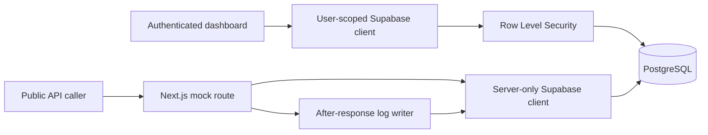

# MockForge

Create mock REST APIs without writing a backend. Configure endpoints in a private dashboard, call them from your frontend, and inspect incoming requests.

Endpoint configuration is stored in PostgreSQL and loaded on every call, so changes take effect without rebuilding or redeploying the application.

## Features

- **Projects and endpoints** — organize APIs by project; create, edit, disable, and delete endpoints.
- **Configurable responses** — choose GET, POST, PUT, PATCH, or DELETE, a status code, and any valid JSON value.
- **Public mock URLs** — exact, case-sensitive routing with CORS support and uncached responses.
- **Request inspection** — private history with endpoint filters, pagination, timing, and limited query metadata.
- **Secure management** — email/password authentication, server-side ownership checks, and PostgreSQL Row Level Security.
- **Responsive workspace** — JSON validation and formatting, copy actions, and confirmed deletion.

> Mock URLs are public. Anyone with a URL can read its configured response. Never include secrets in response JSON or endpoint paths.

## Technology

Next.js 16 App Router · React 19 · TypeScript · Tailwind CSS 4 · Supabase PostgreSQL and Auth · Zod

Testing uses Vitest and Playwright. The application is designed for deployment on Vercel.

## Getting started

### Prerequisites

- Node.js 22.12 or later; Node.js 24 LTS is recommended.
- npm and a Supabase project.

### 1. Install and configure

```bash
npm ci
cp .env.example .env.local
```

Populate `.env.local` using your Supabase project's API settings:

| Variable                               | Purpose                                                       |
| -------------------------------------- | ------------------------------------------------------------- |
| `NEXT_PUBLIC_SUPABASE_URL`             | Supabase project URL                                          |
| `NEXT_PUBLIC_SUPABASE_PUBLISHABLE_KEY` | Publishable key, or legacy `anon` key                         |
| `SUPABASE_SERVICE_ROLE_KEY`            | Server-only key for mock lookups and request logging          |
| `NEXT_PUBLIC_SITE_URL`                 | Canonical application origin; `http://localhost:3000` locally |
| `CRON_SECRET`                          | Server-only secret for the production database keep-alive job |

Keep `.env.local` out of version control. Never prefix the server key with `NEXT_PUBLIC_`. The site URL must be an HTTP(S) origin without a path, query, or credentials. Restart the development server after changing environment variables.

### 2. Apply database migrations

Run these files in the Supabase SQL Editor **in order, once each**:

1. [Initial schema](supabase/migrations/20261022190000_initial_schema.sql)
2. [Foundation hardening](supabase/migrations/20261023090000_foundation_hardening.sql)
3. [Endpoint configuration](supabase/migrations/20261023120000_endpoint_configuration.sql)

For an existing installation, apply only missing migrations. Existing endpoints must satisfy the status, JSON-size, and canonical-path constraints before applying the corresponding migration.

Alternatively, initialize the Supabase CLI configuration if absent, then link your project and push migrations:

```bash
npx supabase init
npx supabase login
npx supabase link --project-ref your-project-ref
npx supabase db push
```

### 3. Configure authentication

In **Supabase → Authentication → URL Configuration**, set:

- Site URL: `http://localhost:3000`
- Redirect URLs: `http://localhost:3000/auth/callback` and `http://localhost:3000/auth/confirm`

Enable email/password sign-up. For confirmation links that work across devices, set the **Confirm signup** email template to:

```html
<a href="{{ .SiteURL }}/auth/confirm?token_hash={{ .TokenHash }}&type=email"
  >Confirm your email</a
>
```

The default PKCE flow through `/auth/callback` is also supported, but must complete in the browser used for sign-up. Add the production URL equivalents before deployment.

### 4. Start the application

```bash
npm run dev
```

Open [localhost:3000](http://localhost:3000), create an account, and configure your first project and endpoint.

## Usage

Create a project with slug `demo`, then add an active `GET /products` endpoint with status `200` and this response:

```json
{
  "products": [{ "id": 1, "name": "Mechanical Keyboard", "price": 129 }]
}
```

Call the generated URL:

```bash
curl -i 'http://localhost:3000/mock/demo/products?page=1'
```

Or use it from your frontend:

```js
const response = await fetch("http://localhost:3000/mock/demo/products", {
  credentials: "omit",
});
const data = await response.json();
```

Statuses 204, 205, and 304 have no response body; skip JSON parsing for those responses. Open **Activity** or the endpoint's detail page and select **Refresh** to inspect recorded calls.

See the [API and request-history reference](docs/api.md) for routing, CORS, errors, privacy rules, and limits.

## Architecture



Dashboard reads and mutations use authenticated clients with ownership checks and RLS. The public runtime and protected database keep-alive job use the administrative client. Request logging runs through Next.js `after`; a logging failure never replaces the configured response.

```text
app/          Pages, Server Actions, authentication, and mock routes
components/   Shared forms, navigation, and request-history UI
lib/          Validation, Supabase clients, runtime, and data access
supabase/     Versioned migrations, optional seed data, and RLS tests
tests/        Unit and live integration tests
docs/         API reference and testing guidance
```

Deleting a user cascades to their projects; deleting a project cascades to its endpoints; deleting an endpoint cascades to its request logs.

## Development

```bash
npm run lint
npm run typecheck
npm test
npm run build
```

Use `npm run test:watch` during development. Live browser tests require a configured test Supabase project:

```bash
npx playwright install chromium
npm run test:e2e
```

See [Testing and demo data](docs/testing.md) for fixture cleanup, RLS checks, and the manual smoke checklist.

## Deployment

1. Import the repository into Vercel using the Next.js preset and a supported Node.js version.
2. Set all variables from [.env.example](.env.example). Use the deployment origin for `NEXT_PUBLIC_SITE_URL`.
3. Apply the migrations to the intended Supabase project.
4. Update Supabase's Site URL, redirect URLs, and confirmation template for your production hostname.
5. Deploy with `npm run build`. Rebuild whenever a `NEXT_PUBLIC_` value changes.
6. Verify authentication, a public mock call, browser CORS, and the resulting request log.

The mock route uses the Node.js runtime with a 15-second duration budget. Keep support for Next.js `after`; this application cannot be deployed as a static export. Deployment Protection can block public API callers on preview URLs, so configure access deliberately. Use separate Supabase projects for testing and production.

### Database keep-alive

[vercel.json](vercel.json) schedules `GET /api/cron/keep-alive` daily at 00:00 UTC. The backend queries Supabase on alternating UTC days, giving a 48-hour target interval across month and year boundaries; intervening calls return `skipped: true` without contacting the database. Vercel's actual invocation time can vary, especially on the Hobby plan.

Set `CRON_SECRET` to a random value of at least 32 characters in the Vercel project's **Production** environment variables, then redeploy. Vercel automatically includes it in the request's `Authorization: Bearer <CRON_SECRET>` header. Cron jobs run only on production deployments, not locally or in previews. On another host, configure a daily scheduler to call this route with the same header.

The job performs an uncached, read-only query for at most one project ID with a five-second timeout. An empty table is still a successful database check; no project data is returned or written. Missing/incorrect authorization is rejected, and database failures return HTTP 503 and emit a generic server log. Check runs in **Vercel → Cron Jobs** after deployment.

This activity is intended to reduce inactivity pauses; it cannot guarantee Supabase availability or restore an already paused project. Resume a paused project in Supabase first.

## Operational limits

- Routing is exact: no dynamic parameters, wildcards, custom domains, or stateful responses.
- Logs contain minimal metadata, not headers, cookies, IP addresses, or request/response bodies.
- Logging is best-effort, with no durable queue or retries. History updates on refresh.
- Automatic log retention and traffic quotas are not implemented. Set storage budgets, retention policies, and platform-level abuse controls before broad public use.
- Hosting access logs are separate from application history; review their privacy and retention settings.
